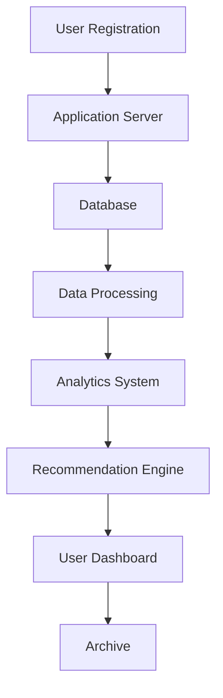

# Laboratory Activity No. 1

- [Laboratory Activity No. 1](#laboratory-activity-no-1)
  - [Title: Mapping the Data Journey of an Everyday Digital Service](#title-mapping-the-data-journey-of-an-everyday-digital-service)
  - [Background](#background)
  - [Laboratory Scenario](#laboratory-scenario)
  - [Part A – Identify the Data](#part-a--identify-the-data)
  - [Part B – Trace the Data Journey](#part-b--trace-the-data-journey)
  - [Part C – Stakeholder Identification](#part-c--stakeholder-identification)
  - [Part D – Data Provenance and Data Lineage](#part-d--data-provenance-and-data-lineage)
  - [Part E – Risk Analysis](#part-e--risk-analysis)
  - [Deliverables](#deliverables)
  - [Grading Rubric (100 Points)](#grading-rubric-100-points)

**Topic:** The Data Journey

**Course:** Data Management and Warehousing

## Title: Mapping the Data Journey of an Everyday Digital Service

## Background

Every digital service that we use today generates data. Whether ordering food, sending a message, watching YouTube, shopping online, or enrolling in school, data continuously moves through different systems before providing value.

This movement is called the **Data Journey**.

A typical data journey consists of:

- Creation/Capture
- Ingestion
- Storage
- Processing
- Integration
- Consumption
- Archival or Disposal

Understanding this journey allows organizations to improve data quality, maintain security, comply with regulations, and support better decision-making.

## Laboratory Scenario

Each group will choose **ONE** everyday digital service.

**Examples:**

- Facebook
- TikTok
- YouTube
- Netflix
- Shopee
- Lazada
- Grab
- FoodPanda
- GCash
- Maya
- Gmail
- Spotify
- University Enrollment System

## Part A – Identify the Data

Complete the table

| **Question** | **Answer** |
| ---- | ---- |
| Name of Digital Service | |
| What data is collected? | |
| Who creates the data? | |
| What type of data is collected? (Structured /  Semi-Structured / Unstructured) | |
| Why is the data collected? | |

## Part B – Trace the Data Journey

Create a flow diagram showing the movement of the data.

Example:

Students should use the stages introduced in the module:

- Creation
- Ingestion
- Storage
- Processing
- Integration
- Consumption
- Archival/Disposal

## Part C – Stakeholder Identification

Identify the people responsible during the data journey.

| **Stage** | **StakeHolder** | **Responsibility** |
| ---- | ---- | ---- |
| Creation | | |
| Storage | | |
| Processing | | |
| Consumption | | |
| Archival | | |

Possible stakeholders include:

- User
- Data Producer
- Data Steward
- Data Engineer
- Data Analyst
- Data Governance Officer
- Decision Maker

## Part D – Data Provenance and Data Lineage

Answer the following questions.

1. Where did the data originate?
2. How can the organization verify that the data is authentic?
3. Describe the data lineage of your chosen data.
4. Why is tracking data lineage important?

## Part E – Risk Analysis

Identify one possible problem that may occur at each stage.

| **Stage** | **Possible Risk** | **Suggested Solution** |
| - | - | - |
| Creation | | |
| Ingestion | | |
| Storage | | |
| Processing | | |
| Integration | | |
| Consumption | | |
| Archival | | |

Students may refer to common challenges such as data silos, loss of context, format incompatibility, latency, and security exposure.

## Deliverables

Each group will submit:

- Completed Activity Sheet
- One-page Data Journey Diagram
- 5-minute Presentation

## Grading Rubric (100 Points)

| Criteria | Points |
| - | - |
| Completeness of Data Journey | 30 |
| Accuracy of Stages | 20 |
| Stakeholder Identification | 15 |
| Risk Analysis | 15 |
| Reflection Answers | 10 |
| Presentation | 10 |
| TOTAL | 100 |
